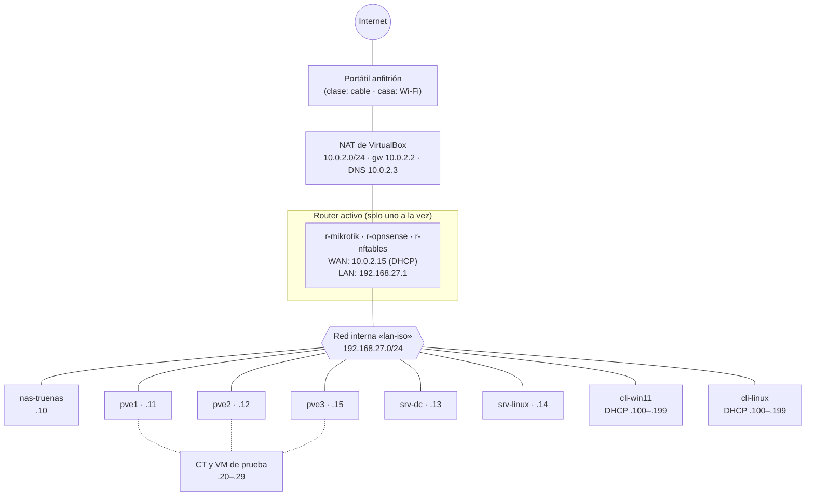

# T4 · Diseño de la red

RA: ISO RA1. Esquema de red de mi entorno, montaje en VirtualBox y direcciones.

## Lo que pide la rúbrica

- [x] Dibujar el esquema de red individual, el montaje virtual y las direcciones previstas.
- [x] Indicar la configuración de cada interfaz y la LAN 192.168.27.0/24 según mi puesto en el aula; la WAN por DHCP con NAT.
- [x] Ampliación: implementarlo y comprobar la conectividad con `ping`, `traceroute` y la tabla de rutas.
- [x] Ampliación: evidencias de `ping`, `traceroute`, rutas y configuración de interfaces entre VM y hacia el exterior.

> **XX = 27 → LAN 192.168.27.0/24.** En el aula mi portátil no tiene un puesto con número fijo: recibe la IP por DHCP. Uso el último número de la IP que tenía en la red del aula el 12/11/2026 (172.16.222.**27**, ver [inventario de clase](../evidencias/t2-inventario-clase-20261112.txt)). No coincide con las redes de los grupos (10, 20, 30 y 40).

## 1. Esquema

## 2. Redes de VirtualBox

| Red de VirtualBox | Tipo | Para qué | Quién se conecta |
|---|---|---|---|
| NAT (la de cada VM) | NAT | WAN del router: salida al exterior | Solo el adaptador 1 del router activo |
| `lan-iso` | Red interna | LAN 192.168.27.0/24 | Adaptador 2 del router y adaptador 1 de todas las demás VM |

**Por qué la WAN en NAT:**
- Funciona igual en clase (cable) y en casa (Wi-Fi). El adaptador puente sobre Wi-Fi suele dar problemas: muchos routers Wi-Fi no aceptan que un mismo portátil use varias direcciones MAC.
- No toca la red del aula: mi router no pide IP ni aparece en 172.16.222.0/24, y es imposible que mi DHCP de pruebas se escape a la red compartida (el enunciado lo prohíbe).
- Inconveniente aceptado: hay **doble NAT** (mi router y VirtualBox). Desde fuera no se puede entrar a mi LAN sin reenviar puertos, pero no hace falta.

**Por qué la LAN en red interna:**
- Es un switch virtual que solo une a las VM que usan el nombre `lan-iso`. El anfitrión y la red real no la ven: la única salida es mi router, como en una empresa.
- Puente o solo-anfitrión mezclarían mi LAN con la red física o con el anfitrión, y el router dejaría de ser el único camino.

**Ajuste para Proxmox:** los adaptadores de `pve1`, `pve2` y `pve3` llevan el *modo promiscuo* en **Permitir todo**. Las VM y contenedores de dentro de Proxmox salen por la tarjeta del nodo, pero cada uno con su propia dirección MAC. Normalmente VirtualBox solo deja pasar el tráfico de la MAC de la VM; sin el modo promiscuo, el resto lo tira y no tendrían red.

## 3. Plan de direcciones

LAN: 192.168.27.0/24 · máscara 255.255.255.0 · difusión 192.168.27.255.

| Rango | Uso | Método |
|---|---|---|
| .1 | Router activo (puerta de enlace) | Fija |
| .10 – .19 | Servidores | Fija |
| .20 – .29 | Contenedores y VM dentro de Proxmox | Fija |
| .100 – .199 | Clientes | DHCP del router |
| Resto | Libre | — |

**Los tres routers usan la misma IP (.1).** Solo hay uno encendido a la vez, así que, al cambiar de router, los demás equipos no se tocan. Lo que cambia es quién da el DHCP y el DNS: si un router no los ofrece, se configura en él o se ponen fijos en los clientes durante esa prueba.

## 4. Configuración de cada interfaz

| VM | Interfaz (VirtualBox) | Red | IP / máscara | Puerta de enlace | DNS | Método |
|---|---|---|---|---|---|---|
| Router activo | Adaptador 1 | NAT | 10.0.2.15/24 | 10.0.2.2 | 10.0.2.3 | DHCP de VirtualBox |
| Router activo | Adaptador 2 | `lan-iso` | 192.168.27.1/24 | — | — | Fija |
| `nas-truenas` | Adaptador 1 | `lan-iso` | 192.168.27.10/24 | 192.168.27.1 | 192.168.27.1 | Fija |
| `pve1` | Adaptador 1 (promiscuo) | `lan-iso` | 192.168.27.11/24 | 192.168.27.1 | 192.168.27.1 | Fija |
| `pve2` | Adaptador 1 (promiscuo) | `lan-iso` | 192.168.27.12/24 | 192.168.27.1 | 192.168.27.1 | Fija |
| `pve3` | Adaptador 1 (promiscuo) | `lan-iso` | 192.168.27.15/24 | 192.168.27.1 | 192.168.27.1 | Fija |
| `srv-dc` | Adaptador 1 | `lan-iso` | 192.168.27.13/24 | 192.168.27.1 | 192.168.27.1 | Fija |
| `srv-linux` | Adaptador 1 | `lan-iso` | 192.168.27.14/24 | 192.168.27.1 | 192.168.27.1 | Fija |
| `cli-win11` | Adaptador 1 | `lan-iso` | 192.168.27.100–199/24 | 192.168.27.1 | 192.168.27.1 | DHCP |
| `cli-linux` | Adaptador 1 | `lan-iso` | 192.168.27.100–199/24 | 192.168.27.1 | 192.168.27.1 | DHCP |

- El DNS de la LAN es el router, que reenvía las consultas al DNS de VirtualBox (10.0.2.3), que a su vez usa el del anfitrión. Así el mismo diseño funciona en clase y en casa.
- Las IP de la WAN son las que da por defecto la NAT de VirtualBox. Se comprobarán al montarlo.

## 5. Camino del tráfico

Un cliente que abre una web: `cli-linux` (192.168.27.1xx) → router por `lan-iso` → el router cambia la IP de origen por la suya, 10.0.2.15 (NAT 1) → NAT de VirtualBox, que la cambia por la del anfitrión (NAT 2) → red de clase o de casa → Internet. La respuesta vuelve por el mismo camino deshaciendo los dos NAT.

## 6. Ampliación: verificación de la conectividad

Hecha el 21/11 con el router `r-nftables` encendido (los otros dos routers se probaron igual en [T5 comunicaciones](05-comunicaciones.md)). Capturas: → [desde `srv-linux`](<../evidencias/t4-red-01-srvlinux-ip-rutas-ping-traceroute-20261121.png>) · [desde el router](<../evidencias/t4-red-02-router-interfaces-rutas-ping-20261121.png>)

| Prueba | Desde | Hacia | Resultado | Qué demuestra |
|---|---|---|---|---|
| `ip -br a` | `srv-linux` | | `enp0s3` 192.168.27.14/24 | La IP fija del plan de direcciones |
| `ip r` | `srv-linux` | | `default via 192.168.27.1` | Todo lo que no es de la LAN se manda al router |
| `ping` | `srv-linux` | Router 192.168.27.1 | 0 % perdidos, 0,6 ms | La LAN funciona |
| `ping` | `srv-linux` | NAS 192.168.27.10 | 0 % perdidos, 0,7 ms | Dos equipos de la LAN se ven entre sí |
| `ping deb.debian.org` | `srv-linux` | Internet, por nombre | 0 % perdidos, 35 ms | Funcionan el DNS (el router responde) y la NAT |
| `traceroute -n 9.9.9.9` | `srv-linux` | Internet | 1) 192.168.27.1 → 2) 10.0.2.2 → 3) 192.168.1.1 → … | El camino del punto 5: **mi router → NAT de VirtualBox → router de casa** → Internet. Se ve la **doble NAT** |
| `ip -br a` | Router | | `enp0s3` 10.0.2.15/24 (WAN, DHCP) y `enp0s8` 192.168.27.1/24 (LAN) | Las dos patas del router, como en el punto 4 |
| `ip r` | Router | | `default via 10.0.2.2 … proto dhcp` | La salida del router la da la NAT de VirtualBox por DHCP |
| `cat /proc/sys/net/ipv4/ip_forward` | Router | | `1` | El router **reenvía** paquetes entre sus dos tarjetas (si fuera `0`, no haría de router) |
| `ping` | Router | `srv-linux` (LAN) y 10.0.2.2 (WAN) | 0 % perdidos en los dos | El router llega a las dos redes |

En el `traceroute` corté a 3 saltos: a partir del 4.º salen IP públicas de mi proveedor de Internet, que no se publican.

## 7. Comparación con la red del grupo

| Aspecto | Grupo 3 | Mi entorno |
|---|---|---|
| LAN | 192.168.30.0/24 | 192.168.27.0/24 |
| WAN | 172.16.222.0/24: IP asignada por el profesor (MikroTik .216) o por puente | NAT de VirtualBox por DHCP |
| Puerta de enlace de la LAN | MikroTik, 192.168.30.1; OPNsense y Debian con otras IP (.2 y .3) | Siempre .1, la del router encendido |
| Switch | Físicos no gestionables (TP-Link) | Red interna de VirtualBox (switch virtual) |
| Separación de redes | El router separa la LAN del grupo de la red del aula | El router separa `lan-iso` de la NAT; la red real no ve mi LAN |
| Doble NAT | No (el router está directamente en la red del aula) | Sí (mi router + NAT de VirtualBox) |
